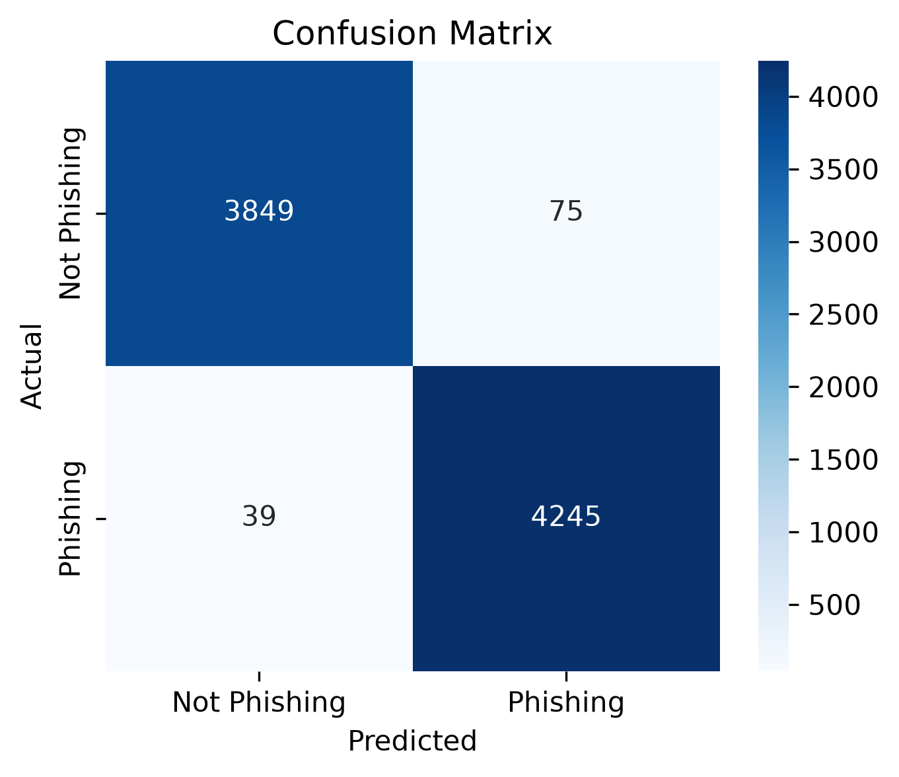

# Phishing Email Detection with BiLSTM

## Overview

This project focuses on detecting phishing emails using a deep learning approach based on a Bidirectional LSTM (BiLSTM) model.

The goal is to classify email text into two categories:

* **0 – Not Phishing**
* **1 – Phishing**

---

## Approach

The project implements a full machine learning pipeline:

1. **Data preprocessing**

   * Removing missing values
   * Removing duplicate texts
   * Lowercasing text
   * Train/Validation/Test split (80/10/10) with stratification

2. **Text processing**

   * Tokenization using Keras Tokenizer
   * Sequence padding to fixed length

3. **Model**

   * Bidirectional LSTM neural network
   * Trained with EarlyStopping and ModelCheckpoint

4. **Evaluation**

   * Accuracy, Precision, Recall, F1-score
   * Confusion Matrix visualization

### Model Tuning


Hyperparameter tuning was performed, and in particular, reducing the embedding size from **256 to 128** led to improved validation performance and better generalization.

This suggests the original model was slightly overparameterized for the dataset.

---


## Results

* **Accuracy:** ~0.99
* **Precision:** ~0.98
* **Recall:** ~0.99
* **F1-score:** ~0.99

### Classification Report

```text
              precision    recall  f1-score   support

           0       0.99      0.98      0.99      3924
           1       0.98      0.99      0.99      4284

    accuracy                           0.99      8208
   macro avg       0.99      0.99      0.99      8208
weighted avg       0.99      0.99      0.99      8208
```

## ! Baseline comparison:

To better understand the effectiveness of the BiLSTM model, a baseline model using Logistic Regression was implemented.

Approach
Text vectorization using CountVectorizer (bag-of-words)

Model: Logistic Regression

Trained on the same train/test split as the neural network
Results

Accuracy: 0.9814

Classification Report:

```text
              precision    recall  f1-score   support

           0       0.98      0.98      0.98      3924
           1       0.98      0.99      0.98      4284

    accuracy                           0.98      8208
   macro avg       0.98      0.98      0.98      8208
weighted avg       0.98      0.98      0.98      8208
```

Logistic Regression achieved ~0.98 accuracy
  indicating that the dataset contains strong lexical patterns

---

## ! Important Note

High performance is partially explained by:

* Clear patterns in phishing text (e.g. *"urgent", "verify account", "click here"*)
* Relatively simple dataset

No data leakage was detected:

* Train/test split performed before tokenization
* Tokenizer fitted only on training data
* No duplicate texts between train and test sets

---

### Dataset

The dataset used in this project is the **Phishing Email Dataset**, available on Kaggle:

[Phishing Email Dataset — Kaggle](https://www.kaggle.com/datasets/naserabdullahalam/phishing-email-dataset)

After downloading the dataset, place the `phishing_email.csv` file in the `data/` directory.

---

## Project Structure

```
BiLSTM/
│
├── data/
│   ├── phishing_email.csv
│   ├── train.csv
│   ├── val.csv
│   └── test.csv
│
├── models/
│   ├── bilstm_model.keras
│   └── tokenizer.pkl
│
├── images/
│   └── confusion_matrix.png
│
├── src/
│   ├── baseline.py
│   ├── config.py
│   ├── evaluate.py
│   ├── model.py
│   ├── preprocessing.py
│   └── train.py
│
├── requirements.txt
├── README.md
└── .gitignore
```
## How to Run

### 0. Install dependencies
```bash
pip install -r requirements.txt
```

### 1. Preprocess data
```bash
python preprocessing.py
```

### 2. Train model
```bash
python train.py
```

### 3. Evaluate model
```bash
python evaluate.py
```

### 4. Run baseline (Logistic Regression)
```bash
python baseline.py
```
---

## Output

Confusion Matrix:



---

## Technologies

* Python
* TensorFlow / Keras
* Scikit-learn
* Pandas
* Matplotlib / Seaborn